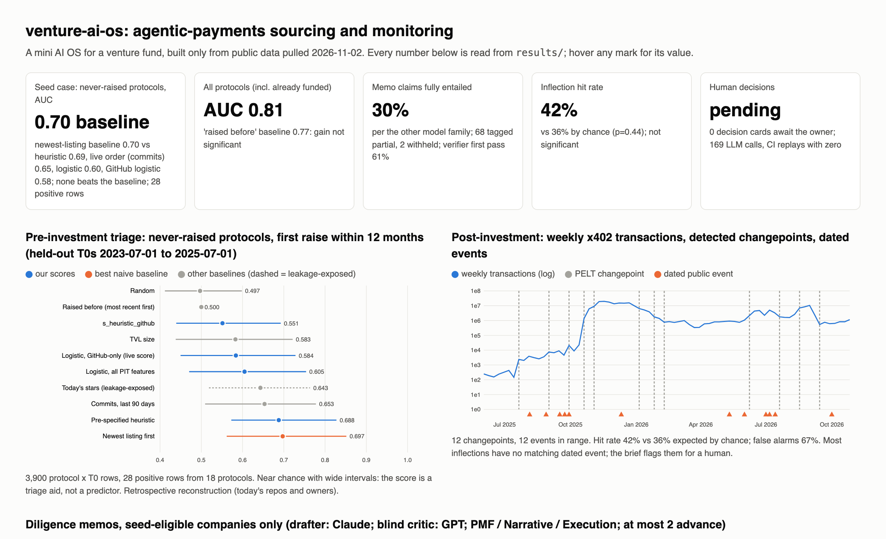
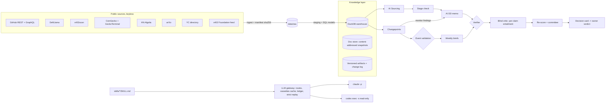

# venture-ai-os

**A mini AI operating system for an early-stage AI x digital-assets fund**: a knowledge layer with receipts,
a skills library, an LLM gateway, and two agent jobs (pre-investment triage-to-memo, post-investment
monitoring-to-brief) in one niche, **agentic payments / agent commerce** (x402, agent wallets, MCP
monetisation). Public data only, pulled 2026-11-02.

**What it is good for, and what it is not.**
- **Triage, not prediction.** On protocols that had never raised (the seed case), no score beats the naive
  "newest listing first" baseline (AUC <!--n:auc_nr_best_base-->0.697<!--/n-->). The pre-specified heuristic gets <!--n:auc_nr_heuristic-->0.688<!--/n--> (95% CI <!--n:auc_nr_heuristic_ci-->0.57-0.83<!--/n-->),
  commits in the last 90 days <!--n:auc_nr_commits-->0.653<!--/n-->, the logistic model <!--n:auc_nr_full-->0.605<!--/n-->, and the GitHub-only logistic model <!--n:auc_nr_github-->0.584<!--/n-->.
  The live queue is ordered by commits in the last 90 days, the best option for GitHub-only candidates (ADR 0010).
  This rests on <!--n:nr_pos-->28<!--/n--> positive rows from <!--n:nr_pos_protocols-->18<!--/n--> protocols, behind <!--n:nr_raises-->22<!--/n--> distinct recorded raises (any type, including token sales; not filtered to first institutional rounds), of which <!--n:nr_seed-->5<!--/n--> were
  seed, pre-seed or angel rounds. Across all protocols the model reaches <!--n:auc_full-->0.810<!--/n-->, but "raised before" alone gets
  <!--n:auc_best_base-->0.773<!--/n-->. So the score orders a long list for a human; it is not evidence and memos never cite it.
- **Receipts that a second model can attack.** Of <!--n:claims_drafted-->102<!--/n--> memo claims, <!--n:raw_precision-->60.8%<!--/n--> passed the deterministic
  verifier on the first draft and all passed after one repair. A blind critic from another model family then
  rated only <!--n:critic_entailed-->30.0%<!--/n--> as fully entailed by their quote. It tagged <!--n:claims_partial-->68<!--/n--> as partial (shown tagged in
  the memo) and withheld <!--n:claims_withheld_critic-->2<!--/n-->. Whether the critic is right is a **human** call, and that call is pending (see "What the owner must do").
- **Monitoring that admits what it cannot explain.** Detected inflections in x402 traction match dated events
  no better than chance: <!--n:cp_hit-->42%<!--/n--> vs <!--n:cp_null-->36%<!--/n--> (p = <!--n:cp_p-->0.44<!--/n-->). The test only had power to detect strong effects:
  <!--n:pw_needed-->8<!--/n--> of 12 events would have had to match. The largest break (October 2025, <!--n:cp_oct_ratio-->~181x<!--/n--> in weekly
  median payments) has no match in the pre-specified event list. In the exploratory list it coincides with a
  cluster of x402-ecosystem token launches; for example, Ping's first DEX pool was created on 2025-10-22, per GeckoTerminal.
  That is consistent with token-mint traffic, but it is a hypothesis, not a validated finding. The weekly brief flags such breaks for a human.



| Problem | What I built | Key results (all from `results/`) |
|---|---|---|
| Overnight sourcing in a fast niche, with no time to read every repo | 6 sources -> entity resolution -> CRM dedupe (SYNTHETIC CRM) -> stage check from sourced evidence -> memo queue of seed-eligible companies | <!--n:n_entities-->1,398<!--/n--> entities; <!--n:stage_checked-->40<!--/n--> stage-checked, <!--n:stage_excluded-->4<!--/n--> excluded as past entry stage (Tempo: incubated by Stripe and Paradigm; Merit Systems: $10M seed led by a16z; Kite: tier-1 backers on homepage) |
| LLM memos invent or overstate facts | Claude drafts with receipts -> deterministic verifier -> blind GPT critic labels every claim -> withheld / tagged -> drafter re-scores -> committee with an advance budget -> decision cards | <!--n:memos-->8<!--/n--> memos: <!--n:recs-->0 advance / 7 watch / 1 pass<!--/n--> (calls follow the score policy); model agreement <!--n:rec_agreement-->8 of 8<!--/n--> (by construction: both calls come from scores via one policy, so only a score band can disagree); <!--n:cards-->0<!--/n--> decision cards; human verdicts pending on all memos |
| Does a public-data score anticipate VC decisions? | Walk-forward point-in-time backtest vs revealed raises (DefiLlama), naive baselines, clustered bootstrap, lead-time analysis | Never-raised: near chance (above). Lead time: the first public GitHub repo predates the first raise in <!--n:lead_gh_share-->73%<!--/n--> of cases (median <!--n:lead_gh_median-->5.0<!--/n--> months), but DefiLlama listing does so in only <!--n:lead_dl_share-->24%<!--/n--> |

---

## Architecture



Each agent owns a job with a spec in `jobs/*.yaml` (inputs, output schema, SLA, eval, failure policy) and
writes a replayable trace in `results/traces/`. Reruns are idempotent: artifacts get a new version only when
their content changes. The two jobs share knowledge: the memo for a facilitator cites what the monitor measured.
The mechanism is tested, but in this run no shortlisted company is an x402 facilitator, so no memo cites monitor findings.
With the round-2 triage order (commits in the last 90 days), PayAI (29 commits in 90 days) no longer makes the queue.
Its corrected 30-day window, [Oct 2, Nov 1), has <!--n:payai_fixed-->441,602<!--/n--> payments. The round-1 window had no end date, so it also counted
Nov 1-2 (<!--n:payai_old-->462,019<!--/n-->). `tests/test_windows.py` now pins the window boundaries.

## Results

### 1. Screening: a retrospective, point-in-time backtest (`make backtest` -> `results/backtest/backtest.json`)
Universe: DefiLlama protocols with a GitHub owner, visible before each T0 (ADR 0003). This is a retrospective
reconstruction: today's owners and top repos are used. Outcome: a raise within 12 months, a revealed investor
decision. Test T0s run every six months from 2023-07-01 to 2025-07-01, and models train only on windows already closed.
Metrics are the mean of per-T0 values, with 95% CIs from 1,000 resamples clustered by protocol. Owner-clustered and "unresolved owners dropped" versions are in the JSON.
The scores, baselines and metrics were committed (ADR 0004) before the first backtest run, after the data had been pulled.

| Population | Rows / positive rows / protocols | Logistic (all features) | Pre-specified heuristic | GitHub-only logistic | Best naive baseline |
|---|---|---|---|---|---|
| Never raised before T0 (seed case) | <!--n:nr_rows-->3,900<!--/n--> / <!--n:nr_pos-->28<!--/n--> / <!--n:nr_pos_protocols-->18<!--/n--> | <!--n:auc_nr_full-->0.605<!--/n--> (<!--n:auc_nr_full_ci-->0.47-0.75<!--/n-->) | <!--n:auc_nr_heuristic-->0.688<!--/n--> | <!--n:auc_nr_github-->0.584<!--/n--> | newest listing <!--n:auc_nr_best_base-->0.697<!--/n--> |
| All protocols | <!--n:bt_rows-->4,655<!--/n--> / <!--n:bt_pos-->80<!--/n--> / <!--n:bt_pos_protocols-->44<!--/n--> | <!--n:auc_full-->0.810<!--/n--> (<!--n:auc_full_ci-->0.724-0.886<!--/n-->); pooled <!--n:auc_full_pooled-->0.821<!--/n--> | <!--n:auc_heuristic-->0.789<!--/n--> | <!--n:auc_github-->0.737<!--/n--> | raised before <!--n:auc_best_base-->0.773<!--/n--> |

All protocols: the <!--n:bt_pos-->80<!--/n--> positive rows come from <!--n:bt_pos_protocols-->44<!--/n--> protocols and <!--n:bt_raises-->58<!--/n--> distinct raises. Only <!--n:bt_seed-->9<!--/n--> of those raises were seed,
pre-seed or angel rounds; the rest are strategic rounds, token sales and later rounds, because the 12-month windows overlap on a 6-month grid.
Logistic minus best baseline: <!--n:auc_diff-->+0.036<!--/n--> (CI <!--n:auc_diff_ci-->-0.022 to +0.100<!--/n-->). The precision@50 lift of <!--n:lift50_full-->9.2x<!--/n--> is the mean of per-T0 lifts, the same
size as the baseline's <!--n:lift50_base-->8.6x<!--/n-->, and precision@50 is <!--n:p50_full-->0.152<!--/n-->. Never-raised, heuristic minus best baseline: CI <!--n:auc_nr_heur_diff_ci-->-0.072 to +0.058<!--/n-->.
For comparison, on never-raised protocols a random score gets <!--n:auc_nr_random-->0.497<!--/n-->, commits in the last 90 days (the live triage order) get <!--n:auc_nr_commits-->0.653<!--/n-->,
and a post-hoc GitHub-signal version of the heuristic gets <!--n:auc_nr_heur_gh-->0.551<!--/n-->.
**Outcome definition:** "raised" means any raise DefiLlama records (seed, strategic, token sale...). It is not
filtered to a first institutional round; for never-raised protocols, it is their first *recorded* raise.
**Lead time (retrospective):** for protocols with a recorded raise, a public GitHub signal existed before the first raise in
<!--n:lead_gh_share-->73%<!--/n--> of cases (signal = creation date of the oldest repo the owner has today; median <!--n:lead_gh_median-->5.0<!--/n--> months). A DefiLlama
listing existed before the raise in only <!--n:lead_dl_share-->24%<!--/n--> (median <!--n:lead_dl_median-->-5.6<!--/n--> months). Caveats: repo creation is neither when a repo
went public nor when a system would have surfaced the company; deleted repos are invisible; <!--n:lead_after_share-->57%<!--/n--> of today's top-5
repos were created after the first raise; <!--n:lead_2020_22-->47%<!--/n--> of these first raises are from 2020-22, mostly DeFi. Read it as: a TVL list
sees most companies only after they raise.

### 2. LLM screening judgment where the model cannot know the answer (`make llm-eval`, ADR 0007)
- **Walk-forward set, anonymized** (opaque ids plus point-in-time features only, so no memorisation channel): <!--n:wf_items-->400<!--/n--> items, all
  <!--n:wf_pos-->80<!--/n--> positive rows plus random negatives (case-control). AUC: Claude <!--n:wf_auc|anonymized|claude-sonnet-5-5-->0.69<!--/n-->, GPT <!--n:wf_auc|anonymized|gpt-6.1-sol-->0.72<!--/n-->;
  the deterministic logistic model on the same items gets <!--n:wf_auc|deterministic|s_logit_full-->0.81<!--/n-->. On never-raised items: Claude <!--n:wf_nr_auc|anonymized|claude-sonnet-5-5-->0.62<!--/n-->, GPT
  <!--n:wf_nr_auc|anonymized|gpt-6.1-sol-->0.61<!--/n-->, heuristic <!--n:wf_nr_auc|deterministic|s_heuristic-->0.70<!--/n-->.
- **Post-cutoff set**: features as of 2026-06-30, raises up to 2026-11-01 (4 months, right-censored), <!--n:pc_items-->120<!--/n--> items with <!--n:pc_pos-->8<!--/n--> raises.
  That the window is after both cutoffs is **assumed, with supporting evidence**. The latest event each model dated correctly
  (<!--n:probe|claude-sonnet-5-5-->2025-12-11<!--/n--> Claude, <!--n:probe|gpt-6.1-sol-->2025-09-29<!--/n--> GPT) is only a lower bound. Both models also missed some 2025 events, and
  "unknown" on niche 2026 events proves nothing. Missing predictions are reported per scorer; there were 0. Anonymized AUC: Claude <!--n:pc_auc|anonymized|claude-sonnet-5-5-->0.78<!--/n-->,
  GPT <!--n:pc_auc|anonymized|gpt-6.1-sol-->0.89<!--/n-->; deterministic <!--n:pc_auc|deterministic|logit_full-->0.91<!--/n-->. Named (leakage-exposed) arm: Claude <!--n:pc_auc|named|claude-sonnet-5-5-->0.87<!--/n-->, GPT <!--n:pc_auc|named|gpt-6.1-sol-->0.89<!--/n-->.
  Counting only the 300 description characters the named arm actually saw, an explicit raise rule matches
  <!--n:pc_mention_pos-->0 of 8<!--/n--> positives and <!--n:pc_mention_neg-->0 of 112<!--/n--> negatives. Effective description leakage is about zero. The one real investor
  phrase in a positive's description sits beyond character 300, and earlier versions of the rule matched "fund" and
  "backed by" false positives. With so few positives, read this as a harness check.

### 3. Receipts (`results/sourcing/run_summary.json`, `make claim-eval`, ADR 0006)
Memos: <!--n:claims_drafted-->102<!--/n--> claims; <!--n:raw_precision-->60.8%<!--/n--> passed the verifier on the first draft, and all passed after one repair.
That "after repair" figure is close to tautological, because failing claims are fixed or dropped. The meaningful number is the critic's:
<!--n:critic_entailed-->30.0%<!--/n--> of claims fully entailed, <!--n:claims_partial-->68<!--/n--> tagged partial, <!--n:claims_withheld_critic-->2<!--/n--> withheld (a claim the critic leaves
unlabelled is withheld too: fail closed). The entailed share partly measures quote scope: a claim that bundles
several facts behind one quote is rarely fully entailed. Splitting claims into one fact each is the next step and
is not done here. Free text (risks, founder questions, rationales, thesis, one-liner) may only state numbers that a shipped
claim or the facts sheet supports; anything else is removed. Recommendations follow the scores under the written policy
(total >= 11 and every dimension >= 3 -> advance; total <= 7 or any 1 -> pass; else watch). Under 25% entailed claims marks the memo
"evidence insufficient" and blocks advance.
Claim-level eval on <!--n:ce_orig-->60<!--/n--> real memo claims and <!--n:ce_pert-->100<!--/n--> labelled perturbations. Critic recall is shown two ways: lenient
counts any label other than "entails"; strict counts only labels that withhold the claim:

| Perturbation | Verifier | Critic, lenient | Critic, strict | Critic, lenient, original entailed (n) |
|---|---|---|---|---|
| swapped number | <!--n:ce_ver|swapped_number-->100%<!--/n--> | <!--n:ce_cri|swapped_number-->100%<!--/n--> | <!--n:ce_cri_strict|swapped_number-->100%<!--/n--> | <!--n:ce_cri_cond|swapped_number-->100%<!--/n--> (<!--n:ce_cond_n|swapped_number-->7<!--/n-->) |
| wrong date | <!--n:ce_ver|wrong_date-->100%<!--/n--> | <!--n:ce_cri|wrong_date-->100%<!--/n--> | <!--n:ce_cri_strict|wrong_date-->100%<!--/n--> | <!--n:ce_cri_cond|wrong_date-->100%<!--/n--> (<!--n:ce_cond_n|wrong_date-->2<!--/n-->) |
| wrong entity | <!--n:ce_ver|wrong_entity-->0%<!--/n--> | <!--n:ce_cri|wrong_entity-->100%<!--/n--> | <!--n:ce_cri_strict|wrong_entity-->0%<!--/n--> | <!--n:ce_cri_cond|wrong_entity-->n/a<!--/n--> (<!--n:ce_cond_n|wrong_entity-->0<!--/n-->) |
| unsupported qualifier | <!--n:ce_ver|added_qualifier-->0%<!--/n--> | <!--n:ce_cri|added_qualifier-->100%<!--/n--> | <!--n:ce_cri_strict|added_qualifier-->2%<!--/n--> | <!--n:ce_cri_cond|added_qualifier-->100%<!--/n--> (<!--n:ce_cond_n|added_qualifier-->10<!--/n-->) |

The verifier is blind to entity swaps and embellishment by design (it checks spans and numbers). A perturbation the
critic labels "partial" still ships, with a tag; that is why strict recall matters. No inter-rater agreement is
reported, because the critic was not re-run on the same pairs. The critic also flags <!--n:ce_critic_flag_orig-->83%<!--/n--> of the unperturbed claims as not fully entailed. That rate is an upper
bound on its false positives. Its precision is unknown until the owner labels `results/adjudication/flag_sample.csv`.

### 4. Inflection points (`make monitor`, `make monitor-diagnostics`, ADR 0005 / 0009)
Weekly x402 payments, all chains: <!--n:cp_n-->12<!--/n--> changepoints against <!--n:cp_events-->12<!--/n--> dated events (the x402 Foundation feed, three verified
launches, and HN stories with at least 15 points). Hit rate <!--n:cp_hit-->42%<!--/n--> vs <!--n:cp_null-->36%<!--/n--> by chance (p = <!--n:cp_p-->0.44<!--/n-->); false alarms <!--n:cp_fa-->67%<!--/n-->. **Target missed.**
Exploratory diagnostics, all added after the miss:
- **Power:** <!--n:pw_needed-->8<!--/n--> of 12 events would have had to match for p < 0.05. The power at a true hit rate of 70% is <!--n:pw_07-->72%<!--/n-->.
- **Real-time replay:** on expanding windows, the median detection delay is <!--n:rt_delay-->1<!--/n--> weeks, and <!--n:rt_dropped-->3<!--/n--> alarms raised in real time later disappeared.
- **Matched alarm counts:** at the same number of alarms (<!--n:mc_k-->12<!--/n-->), PELT's false-alarm rate is <!--n:mc_pelt_fa-->67%<!--/n--> vs <!--n:mc_z_fa-->75%<!--/n--> for the z-score detector.
- **Event list v2:** adding every x402-ecosystem token's first DEX pool (GeckoTerminal) as a crypto catalyst gives <!--n:v2_events-->52<!--/n--> events, a hit rate of <!--n:v2_hit-->44%<!--/n-->
  vs <!--n:v2_null-->32%<!--/n--> by chance (p = <!--n:v2_p-->0.03<!--/n-->). Because this list was extended after the fact, it is a hypothesis, not a validation.
- **September 2026 drop:** the artifact check (daily shape, facilitator shares, public x402scan commits) is in the JSON.
  It is a one-day step on 2026-09-08 on Solana: daily payments fell from about 1.7 million to under 200 thousand, then to
  about 17 thousand, while Base stayed flat at about 55 thousand a day. Most of the drop is in two facilitators, PayAI and Figment.
  The public x402scan repo shows no indexer change in that window. From public data alone, "one large payer stopped" and
  "indexing changed" cannot be told apart, so the brief marks it as needing a human.
- **Portfolio-style KPI brief for one named comparable,** Daydreams: `results/briefs/company_daydreams.md`.

## What the owner must do (not automated, not pre-filled)
1. Read each memo in `results/memos/` (and any decision card in `results/decision_cards/`) and record a verdict and reason:
   `uv run python -m vaios.decide record <entity> --verdict advance|watch|pass --reason "..." --reviewer <name>`.
2. Label the critic-flag sample: open `results/adjudication/flag_sample.csv`, or run `uv run python -m vaios.decide label <entity>:<claim> --label entails|partial|contradicts --reviewer <name>`.
3. `uv run python -m vaios.decide status` then reports agreement between the human and each agent. Until then, human agreement is **pending**.
Both ledgers (`ledger/human_feedback.jsonl`, `ledger/flag_adjudication.jsonl`) are empty on purpose. Format examples live in `ledger/human_feedback.example.jsonl`.

## Key SQL (DuckDB, `src/vaios/sql/`)

Point-in-time TVL at T0 (no row dated on or after T0 can enter):
```sql
SELECT u.t0, u.slug,
       arg_max(t.tvl_usd, t.day) FILTER (WHERE t.day < u.t0)                     AS tvl_t0,
       arg_max(t.tvl_usd, t.day) FILTER (WHERE t.day < u.t0 - INTERVAL 90 DAY)   AS tvl_t0_90
FROM universe u JOIN stg_tvl_daily t ON t.slug = u.slug AND t.day < u.t0
GROUP BY 1, 2;
```
Outcome label, kept in a separate table from the features:
```sql
SELECT f.t0, f.slug, COUNT(r.slug) > 0 AS raised, COALESCE(SUM(r.amount_musd), 0) AS amount_musd
FROM features_pit f JOIN asof_dates a ON a.t0 = f.t0
LEFT JOIN raises r ON r.slug = f.slug AND r.raise_date >= f.t0 AND r.raise_date < a.outcome_end
GROUP BY 1, 2;
```
Listing date without backfill leakage (DefiLlama backfills TVL when it lists a protocol):
```sql
CASE WHEN p.listed_at IS NOT NULL THEN p.listed_at
     WHEN f.first_tvl_day < TIMESTAMP '2021-10-14' THEN TIMESTAMP '2021-10-14' END AS listed_at_eff
```

## Data sources

| Source | What | Access / terms |
|---|---|---|
| [GitHub API](https://docs.github.com/en/rest) | repo search, commit-history windows (GraphQL), READMEs, contributors, org websites | `gh` auth; GitHub API terms |
| [DefiLlama API](https://defillama.com/docs/api) | protocols, TVL history, per-protocol raises | free endpoints (the bulk `/raises` endpoint is paid and not used) |
| [x402scan](https://www.x402scan.com) ([source](https://github.com/Merit-Systems/x402scan)) | daily x402 transfers by chain and facilitator | public endpoints of an open-source explorer |
| [CoinGecko API](https://www.coingecko.com/en/api) / [GeckoTerminal API](https://www.geckoterminal.com/dex-api) | token markets, FDV, 365-day charts / DEX pool creation dates | public tiers, attribution |
| [HN Algolia](https://hn.algolia.com/api) | stories, dated | public |
| [arXiv API](https://info.arxiv.org/help/api/) | agent-payment papers | arXiv API terms |
| [YC directory (yc-oss mirror)](https://github.com/yc-oss/api) | companies, batches | public mirror of the YC directory |
| [x402 Foundation feed](https://x402.org/feed/) | dated first-party announcements | public RSS |
| Company homepages | funding sentences, investor logos, about pages (stage check) | fetched once, stored as snapshots |

Raw pulls are gitignored. Every file is listed with its URL, fetch time and sha256 in `results/data_manifest_files.csv.gz`.
The small point-in-time tables that every number is computed from are committed in `results/frozen/`.

## How to run

```bash
make init          # uv sync --locked + headless chromium
make check         # offline: ruff + tests + feature regression check
make verify        # every feature verification; exits non-zero if any feature is open without an approved block;
                   # evidence SHAs are written only when a state changes, so a clean HEAD stays clean
make replay        # every LLM job with VAIOS_STRICT_REPLAY=1: zero model calls, identical outputs
make live-run      # LOCAL: pulls only what is missing, rebuilds warehouse + shortlist, budgeted cached LLM calls
make reproduce     # everything from live pulls (LLM calls are cached)
```
CI (`ci.yml`) and the scheduled workflow (`nightly.yml`) run **strict replay from cassettes**. They prove that
the jobs still run end to end with zero calls; they do not source anything new. `make live-run` is closer to live,
but not fully: ingest is idempotent, so existing raw files (GitHub activity, DefiLlama protocol details, token data)
are reused rather than re-pulled. The as-of dates in `config.py` are fixed (AS_OF = 2026-11-01). A true nightly
run would clear `data/raw` and advance AS_OF.
Docker: `docker build -t venture-ai-os . && docker run --rm venture-ai-os`. Tableau: `extracts/*.csv` + `docs/tableau.md`.

## How this maps to an AI-native fund's workflow

| Fund concept | Here |
|---|---|
| Context layer of memos, market maps, call notes | DuckDB warehouse + content-addressed snapshot store + versioned artifacts with a change log |
| Every output leaves receipts | claim-level citations checked by code and by a second model; a trace per run; artifact provenance |
| Agents own jobs, not prompts | `jobs/*.yaml` specs; pydantic outputs; per-company failure isolation; a run fails if any company fails |
| Agents critique each other, humans in the loop | blind cross-family critique, committee with an advance budget, decision cards, owner verdict ledger (pending) |
| Held-out evaluation for forecasting | walk-forward point-in-time backtest; LLM judgment on anonymized and post-cutoff sets |
| AI gateway | one gateway: routing, cache/replay, ledger, budget |

**Deploying to a portfolio company.** `make export-skills` writes `dist/founder-skills-bundle/` (SKILL.md folders plus output
schemas). `company-brief` shows the intended use: point the KPI brief at one company's own series.

## Known limitations / what differs from production

- The screening backtest is a retrospective reconstruction on DefiLlama-listed crypto protocols, not seed-stage AI startups
  (ADR 0003). Unresolved owners make negatives look inactive: owners resolve for 96% of positive rows vs 90% of negative rows.
- Funding coverage is DefiLlama's. Raises before listing are invisible, and missing raises count as negatives.
- The stage check only knows what homepages, DefiLlama, YC and CoinGecko say. "Unknown" is not "early".
- The critic's precision is unmeasured until the owner labels the adjudication sample, and it may over-flag.
- The changepoint test missed and was underpowered. All monitoring diagnostics are post-hoc.
- Hooks in `.claude/` are guardrails for Edit/Write tool calls; shell writes are not covered.
- The CRM is SYNTHETIC. Paid data (PitchBook, Crunchbase, Messari, Dune) would plug in as one more `ingest/` module.
- Not affiliated with any fund. Companies named here are public comparables, not recommendations.
