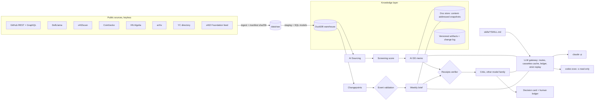

# venture-ai-os

**A mini AI operating system for an early-stage AI x digital-assets fund**: a knowledge layer with receipts,
a skills library, an LLM gateway, and two agent jobs that own real investment workflows. Niche:
**agentic payments / agent commerce** (x402, agent wallets, MCP monetisation). Public data only, pulled 2026-11-02.

**Headline.** On held-out dates, a point-in-time screening score ranks the crypto protocols that go on to
announce a VC raise within 12 months at **AUC 0.810** (95% CI 0.725-0.886), with precision@50 at **9.0x** the
1.7% base rate. But the simplest investor heuristic, "already raised before", gets AUC 0.773 and 8.6x, and the
paired gain of +0.036 (95% CI -0.022 to +0.100) is **not distinguishable from zero**. Diligence memos ship only
machine-verified claims (first-draft citation precision 88.7%, 100.0% after one repair round), and a second model
family still flags 32 of 106 shipped claims as overreaching. Detected inflection points in x402 traction line up
with public announcements no better than chance (42% vs 36%, p = 0.44), so the weekly brief sends them to a human.


| Problem | What I built | Key results (all from `results/`) |
|---|---|---|
| Sourcing and first-pass diligence on a fast-moving niche take analyst days, and LLM memos invent facts | Nightly job: 6 public sources -> entity resolution -> CRM dedupe -> backtested score -> memo by Claude with enforced receipts -> critique by GPT -> decision card for the human | 1,398 entities sourced, 8 memos, 106 claims drafted, 88.7% verified on first pass, 100.0% after repair, 32 flagged by the critic, 8 decision cards |
| Is a screening score any better than what an investor would do anyway? | Walk-forward point-in-time backtest against revealed VC decisions (DefiLlama raises), naive baselines, protocol-clustered bootstrap | 4,655 protocol x date rows, 80 raises, AUC 0.810 vs best baseline 0.773; gain +0.036 not significant |
| Post-investment: spot inflection points in comparables before the quarterly update | PELT changepoints on x402 traction (x402scan) validated against a pre-registered list of dated events, plus a weekly brief with receipts | 12 changepoints, 12 events, hit rate 42% vs 36% chance, false alarms 67% (z-score baseline 57%) |

---

## Architecture



Every agent owns a job with a spec in `jobs/*.yaml` (inputs, output schema, SLA, eval, failure policy) and
writes a replayable trace (`results/traces/`): inputs, each step, model, cache key, prompt and output hashes,
cited doc_ids. Reruns are idempotent: artifacts get a new version only when content changes.

## The two jobs

**Pre-investment (`make sourcing-run`, nightly cron in `.github/workflows/nightly.yml`).**
1. *Sourcing*: GitHub niche search (14 queries), DefiLlama niche categories, YC directory, x402scan facilitators,
   HN Show/Launch HN, CoinGecko "x402 Ecosystem" -> union-find entity resolution on name, GitHub owner and
   domain -> relevance (niche keyword score) and investability filters (incumbents, standards bodies, personal
   accounts out) -> dedupe against the fund CRM (`synthetic/crm_pipeline.csv`, **SYNTHETIC**).
2. *Screening*: the GitHub-only backtested model, because most niche startups are not on DefiLlama.
3. *Memo* (`skills/diligence-memo`): Claude drafts 8-14 claims, each with a receipt (snapshot quote or warehouse
   metric). The verifier rejects any claim whose quote is not in the snapshot or whose numbers do not match;
   the drafter gets one repair round; still-failing claims are withheld.
4. *Critique* (`skills/memo-critic`): GPT re-scores PMF / Narrative / Execution, flags claims whose quote does not
   support the text, lists missing risks. Any disagreement produces a decision card (`results/decision_cards/`);
   the human verdict goes to `ledger/human_feedback.jsonl` (schema ready; the two seed rows are marked EXAMPLE).

**Post-investment (`make monitor brief`).** Weekly x402 transactions, volume and buyers by chain and by
facilitator (the comparable companies: Coinbase CDP, PayAI, Dexter, Daydreams, Heurist, Figment) -> PELT -> the
brief explains each recent inflection with receipts and marks unexplained ones `needs human`.

## Results

### 1. Screening backtest (`make backtest` -> `results/backtest/backtest.json`)
Universe: DefiLlama protocols with a GitHub owner, visible before each T0 (ADR 0003). Outcome: any raise in
DefiLlama's per-protocol `raises` within 12 months of T0, i.e. a revealed investor decision. Test T0s:
2023-07-01 to 2025-07-01 every six months; models train only on windows already closed at T0.
Sample: 4,655 rows, 1,180 protocols, 80 raises (base rate 1.7%). Score definitions were pre-registered (ADR 0004).

| Scorer | AUC (95% CI) | Lift@50 |
|---|---|---|
| Logistic, all point-in-time features | 0.810 (0.725-0.886) | 9.0x |
| Pre-registered heuristic (no fitting) | 0.789 | |
| Logistic, GitHub-only (the live niche score) | 0.736 | |
| Best naive baseline: raised before | 0.773 | 8.6x |
| Reference only: today's GitHub stars (leakage-exposed) | 0.726 | |

Paired AUC gain over the best baseline: +0.036 (95% CI -0.022 to +0.100). Honest reading: public traction
features anticipate raises well, but most of the signal is "this team has raised before"; the model is not
proven better than that heuristic. Precision@50 of the full model: 0.148.

### 2. LLM judgment, only where the model cannot know the answer (`make llm-eval`, ADR 0007)
Features frozen at 2026-06-30 (assumed model cutoff), outcomes from then to 2026-11-01; 120 protocols, 8 raises.

| Scorer | AUC |
|---|---|
| Deterministic logistic (all features) | 0.91 |
| Deterministic, raised before | 0.85 |
| Deterministic, GitHub-only | 0.75 |
| Claude, anonymized features | 0.81 |
| GPT, anonymized features | 0.80 |
| Claude, named + current description (leakage-exposed) | 0.91 |
| GPT, named + current description (leakage-exposed) | 0.87 |

With 8 positives every interval is wide (see the JSON). On clean inputs the LLMs do not beat the deterministic
score; the named arm improves, but 4 of the 8 positives' current descriptions mention funding, so that gain is
not evidence of judgment.

### 3. Receipts (`results/sourcing/run_summary.json`)
8 memos, 106 claims drafted; 88.7% verified on the first pass, 100.0% after one repair round, 106 shipped.
The critic still flags 32 shipped claims as not supported by their quote, which is the gap a span check cannot
close (ADR 0006). The verifier itself is tested (`make verifier-eval`): it accepts all 266 real spans in a gold
set and rejects 500 of 500 programmatic corruptions (100.0%). Disclosure: the first run caught 498; the two
misses were HN boilerplate lines differing only in an item id, which the fuzzy match tolerated, so fuzzy matches
now also require every number in the quote to exist in the snapshot. The corruption set was not changed.
The weekly brief: 81.2% of 16 claims verified on the first pass, 16 shipped. Recommendation agreement between the two model families: 1 of 8;
all 8 memos produced a decision card.

### 4. Inflection points (`make monitor` -> `results/monitoring/changepoints.json`, ADR 0005)
On weekly x402 transactions (all chains): 12 changepoints against 12 dated events (x402 Foundation feed, three
verified third-party launches, HN stories >= 15 points). Event hit rate 42%, versus 36% for the same number of
changepoints placed at random (p = 0.44); false alarms 67% versus 57% for a z-score detector. **Target missed.**
The largest moves (October 2025 up ~180x in weekly median; September 2026 down ~90%) have no matching
announcement. That is the useful finding: x402 usage is driven by on-chain activity that press releases do not
predict, so a monitor must surface unexplained breaks to a human rather than narrate them.

## Key SQL (DuckDB, `src/vaios/sql/`)

Point-in-time TVL at T0 (no row on or after T0 can enter):
```sql
SELECT u.t0, u.slug,
       arg_max(t.tvl_usd, t.day) FILTER (WHERE t.day < u.t0)                     AS tvl_t0,
       arg_max(t.tvl_usd, t.day) FILTER (WHERE t.day < u.t0 - INTERVAL 90 DAY)   AS tvl_t0_90
FROM universe u JOIN stg_tvl_daily t ON t.slug = u.slug AND t.day < u.t0
GROUP BY 1, 2;
```
Outcome label, kept in a separate table from features:
```sql
SELECT f.t0, f.slug, COUNT(r.slug) > 0 AS raised, COALESCE(SUM(r.amount_musd), 0) AS amount_musd
FROM features_pit f JOIN asof_dates a ON a.t0 = f.t0
LEFT JOIN raises r ON r.slug = f.slug AND r.raise_date >= f.t0 AND r.raise_date < a.outcome_end
GROUP BY 1, 2;
```
Listing date without backfill leakage (DefiLlama backfills TVL when it lists a protocol):
```sql
CASE WHEN p.listed_at IS NOT NULL THEN p.listed_at
     WHEN f.first_tvl_day < TIMESTAMP '2021-10-14' THEN TIMESTAMP '2021-10-14' END AS listed_at_eff
```

## Data sources

| Source | What | Access / terms |
|---|---|---|
| [GitHub API](https://docs.github.com/en/rest) | repo search, commit history windows (GraphQL), READMEs | `gh` auth; GitHub API terms |
| [DefiLlama API](https://defillama.com/docs/api) | protocols, TVL history, per-protocol raises | free endpoints (bulk `/raises` is paid and not used) |
| [x402scan](https://www.x402scan.com) ([source](https://github.com/Merit-Systems/x402scan)) | daily x402 transfers by chain and facilitator | public endpoints of an open-source explorer |
| [CoinGecko API](https://www.coingecko.com/en/api) | token markets and 365-day charts | public tier, attribution |
| [HN Algolia](https://hn.algolia.com/api) | stories, dated | public |
| [arXiv API](https://info.arxiv.org/help/api/) | agent-payment papers | arXiv API terms |
| [YC directory (yc-oss mirror)](https://github.com/yc-oss/api) | companies, batches | public mirror of the YC directory |
| [x402 Foundation feed](https://x402.org/feed/) | dated first-party announcements | public RSS |

Raw pulls are gitignored; every file is listed with URL, fetch time and sha256 in
`results/data_manifest_files.csv.gz`. The small point-in-time tables every number is computed from are
committed in `results/frozen/`. Probe results, including what does not work (star timestamps, bulk raises),
are in ADR 0001.

## How to run

```bash
make init          # uv sync --locked + headless chromium
make check         # offline: ruff + tests + feature regression check (about 20 s)
make verify        # runs every feature verification, writes feature_list.json states
make replay        # re-runs every LLM job with VAIOS_STRICT_REPLAY=1: zero model calls, identical outputs
make reproduce     # live pulls -> warehouse -> backtest -> LLM jobs (cached) -> dashboard
```
Docker: `docker build -t venture-ai-os . && docker run --rm venture-ai-os` runs the offline gate.
Tableau: `extracts/*.csv` and the workbook design in `docs/tableau.md`.

## How this maps to an AI-native fund's workflow

| Fund concept | Here |
|---|---|
| Context layer of memos, market maps, call notes | DuckDB warehouse + content-addressed snapshot store + versioned artifacts with change log |
| Every output leaves receipts | claim-level citations checked by code; trace per run; artifact provenance (doc_ids, cache keys, metric keys) |
| Agents own jobs, not prompts | `jobs/*.yaml` specs with SLA, output schema and eval; pydantic outputs; failure isolation per company |
| Agents critique each other, humans in the loop | cross-family critique, decision cards, human feedback ledger |
| Held-out evaluation for forecasting | walk-forward point-in-time backtest; LLM judgment only on post-cutoff outcomes |
| AI gateway | one gateway: routing, cache/replay, ledger, budget |
| Overnight sourcing | nightly cron workflow |

**Deploying to a portfolio company.** `make export-skills` writes `dist/founder-skills-bundle/`: the SKILL.md
folders plus JSON schemas for their outputs. A founder drops `skills/` into `.claude/skills/` or references it
from `AGENTS.md`; the receipts rule and the rubric travel with it. For example, a portfolio company in agent
payments can point `inflection-explainer` at its own x402 facilitator series to get the same weekly brief.

## Known limitations / what differs from production

- The backtest universe is DefiLlama-listed crypto protocols, broader than the agentic-payments niche (ADR 0003);
  raises before a protocol is listed are invisible. Top repos per owner are chosen by today's stars.
- GitHub star history is not available, so popularity enters only as a leakage-exposed reference.
- The live niche score is the weaker GitHub-only model (AUC 0.736 in the backtest).
- 8 post-cutoff raises make the LLM-judgment comparison a harness check, not a verdict.
- The verifier proves a quote exists, not that it supports the claim; the critic covers part of that gap.
- The changepoint method missed its pre-registered target; the event list is small (12 in range).
- Entity resolution is heuristic (e.g. a facilitator id is matched to a GitHub owner by prefix).
- The CRM is SYNTHETIC; real deployment would read the fund's CRM and write decision-card verdicts back to it.
- Paid data (PitchBook, Crunchbase, Messari, Dune) would plug in as one more `ingest/` module with the same
  manifest contract.
- Not affiliated with any fund. Companies named here are public comparables, not recommendations.
